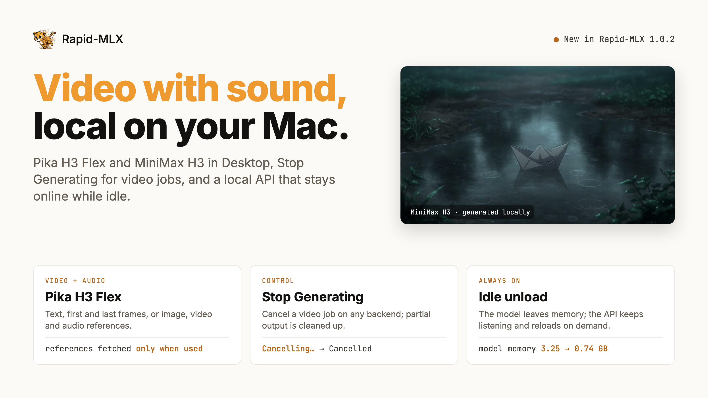

Rapid-MLX 1.0.2 generates video with synchronized sound, lets you stop a video job, and lets Desktop unload an idle model while the local API stays online. New installs start faster with a smaller default model, and the CLI accepts pasted Hugging Face links. It also fixes model selection, downloads, installs and Simplified Chinese and VoiceOver coverage found while testing 1.0.1.

**Download:** [Rapid-MLX Desktop for macOS](https://github.com/raullenchai/Rapid-MLX/releases/download/rapid-mac-v1.0.2/rapid-mlx-desktop.dmg) | CLI: `rapid-mlx upgrade` or `curl -fsSL https://rapidmlx.com/install.sh | bash`

## Video with Sound: Pika H3 Flex

Pika H3 Flex generates video with a synchronized audio track, from a text prompt, a first frame, first and last frames, or image, video and audio references. Desktop adds MiniMax H3 and Pika H3 Flex to the Video tab and shows only the reference controls the selected model and this Mac support ([#5557](https://github.com/raullenchai/Rapid-MLX/pull/5557), [#5559](https://github.com/raullenchai/Rapid-MLX/pull/5559), [#5570](https://github.com/raullenchai/Rapid-MLX/pull/5570), [#5581](https://github.com/raullenchai/Rapid-MLX/pull/5581)).

*Generated locally with MiniMax H3 (Turbo, 8 steps, 720p). Click the image to play the 5-second clip.*

| Mode | Inputs | Extra download |
|---|---|---|
| Text to video | prompt | none |
| First frame, or first and last frames | prompt + 1–2 images | none |
| References to video | prompt + image, video or audio references | about 69 GB on first use |

The reference assets are fetched only the first time you use references, so text and frame users skip about 69 GB; `rapid-mlx pull pika-h3-flex --with-ref2va` prefetches them ([#5563](https://github.com/raullenchai/Rapid-MLX/pull/5563)). Desktop decodes video and audio references with its bundled media tools, with nothing extra to install.

Video jobs can now be stopped. Desktop shows **Stop Generating**, then “Cancelling…”, and keeps the job as “Cancelled”; the server cancels on every video backend and removes partial output ([#5564](https://github.com/raullenchai/Rapid-MLX/pull/5564), [#5569](https://github.com/raullenchai/Rapid-MLX/pull/5569)).

## Idle Unload Keeps the API Online

Desktop can unload an idle chat model without stopping the server. The next request, from Desktop or any client of the local API, loads it again. Settings adds a 5-minute option, and the sidebar shows unloaded and reloading states ([#5580](https://github.com/raullenchai/Rapid-MLX/pull/5580)).

| After the idle timeout | 1.0.1 | 1.0.2 |
|---|---|---|
| Local API | stopped | keeps running |
| Model memory (Qwen3.5 4B, measured) | freed by stopping the server | 3.25 GB → 0.74 GB |
| Next request | start the server again | reloads the model automatically |

Speech models and older runtimes still stop the server when idle.

## New Features and Improvements

- **Faster first run:** new installs start with LFM2.5 2.6B, a 1.6 GB download instead of 3.06 GB, so the first reply arrives sooner. Choosing a model that fits goes straight to “Download & start”; only a model this Mac cannot run opens the compatibility details. On Macs with 32 GB or more, Qwen 3.5 4B is one click away for image questions ([#5614](https://github.com/raullenchai/Rapid-MLX/pull/5614), [#5615](https://github.com/raullenchai/Rapid-MLX/pull/5615), [#5626](https://github.com/raullenchai/Rapid-MLX/pull/5626)).
- **Paste Hugging Face links:** `serve`, `chat`, `run`, `pull`, `rm`, `info` and `bench` accept a pasted huggingface.co, hf.co or hf-mirror.com model URL and print the `org/name` they use. `rapid-mlx pull <link> --check --json` reports whether a model will run on this Mac without downloading it. In Desktop, paste a link into model management search, or choose **Add from Hugging Face…** in the model menu; unsupported models say why. When a repo also ships extra per-quantization folders, only the checkpoint that runs is downloaded ([#5617](https://github.com/raullenchai/Rapid-MLX/pull/5617), [#5620](https://github.com/raullenchai/Rapid-MLX/pull/5620), [#5621](https://github.com/raullenchai/Rapid-MLX/pull/5621), [#5622](https://github.com/raullenchai/Rapid-MLX/pull/5622), [#5624](https://github.com/raullenchai/Rapid-MLX/pull/5624), [#5627](https://github.com/raullenchai/Rapid-MLX/pull/5627), [#5628](https://github.com/raullenchai/Rapid-MLX/pull/5628), [#5629](https://github.com/raullenchai/Rapid-MLX/pull/5629)).
- **Model picker:** the chat picker lists downloaded models, the selected and serving models, and in-progress downloads (disabled); “Browse all models…” opens model management. Duplicate aliases are gone, draft-only MTP models are no longer offered as chat models, and video and catalog models show readable names ([#5566](https://github.com/raullenchai/Rapid-MLX/pull/5566), [#5601](https://github.com/raullenchai/Rapid-MLX/pull/5601), [#5603](https://github.com/raullenchai/Rapid-MLX/pull/5603), [#5609](https://github.com/raullenchai/Rapid-MLX/pull/5609), [#5610](https://github.com/raullenchai/Rapid-MLX/pull/5610)).
- **Simplified Chinese and VoiceOver:** more of Settings, Audio, Images, Video and About is translated, including the benchmark meter axes and the Vision badge. VoiceOver reads the resident-model lock as “Kept in memory” and skips decorative symbols ([#5540](https://github.com/raullenchai/Rapid-MLX/pull/5540), [#5602](https://github.com/raullenchai/Rapid-MLX/pull/5602), [#5603](https://github.com/raullenchai/Rapid-MLX/pull/5603), [#5611](https://github.com/raullenchai/Rapid-MLX/pull/5611)).
- **Downloads:** `pull` checks memory and free disk before downloading and shows the file plan, also for direct repository downloads (`--no-preflight` stages a model for another Mac). A slow-mirror fallback resumes the verified partial file instead of starting over ([#5592](https://github.com/raullenchai/Rapid-MLX/pull/5592), [#5545](https://github.com/raullenchai/Rapid-MLX/pull/5545)).
- **Automatic MTP:** the pinned MTP head downloads with its model when eligible, including on the first `serve`, without a manual pull and restart. Offline mode and download opt-outs are respected ([#5599](https://github.com/raullenchai/Rapid-MLX/pull/5599), [#5535](https://github.com/raullenchai/Rapid-MLX/pull/5535)).
- **Agents:** agent setup finds the running server, waits while it downloads or loads, and can write configuration offline when you name a model. Agent configs use the memory-fitted context window ([#5582](https://github.com/raullenchai/Rapid-MLX/pull/5582), [#5585](https://github.com/raullenchai/Rapid-MLX/pull/5585), [#5595](https://github.com/raullenchai/Rapid-MLX/pull/5595)).
- **MTP on the server:** the server keeps the prompt history the MTP head drafts from, so more drafts are accepted, and keeps the decode thread on performance cores. On an M5 Max 36 GB with Qwen3.8 27B 4-bit MTP, these measured +8% and +6% decode over HTTP; on an M3 Ultra we measured no change ([#5571](https://github.com/raullenchai/Rapid-MLX/pull/5571), [#5586](https://github.com/raullenchai/Rapid-MLX/pull/5586)).
- **Adaptive thinking:** requests get a bounded reasoning budget from the server's configured effort, medium (2,048 tokens) by default, so answers start sooner. An explicit effort in the request still wins ([#5604](https://github.com/raullenchai/Rapid-MLX/pull/5604)).
- **Community Benchmark:** fixed-schedule image benchmarks support 4-, 8- and 28-step models, and Desktop shows the protocol, step count and guidance that ran. Waits time out per output rather than per round ([#5546](https://github.com/raullenchai/Rapid-MLX/pull/5546), [#5547](https://github.com/raullenchai/Rapid-MLX/pull/5547), [#5548](https://github.com/raullenchai/Rapid-MLX/pull/5548), [#5600](https://github.com/raullenchai/Rapid-MLX/pull/5600)).
- **Terminal banner:** interactive CLI commands open with a clear RAPID-MLX wordmark instead of the hard-to-read cheetah face ([#5613](https://github.com/raullenchai/Rapid-MLX/pull/5613)).
- **Privacy:** anonymous setup measurements resume after relaunch and add fixed milestones for model choice, catalog failure and skipped setup. First-reply time is bucketed on device. Anonymous metrics also record which normalized model ids people check or add, so the catalog can prioritize them ([#5550](https://github.com/raullenchai/Rapid-MLX/pull/5550), [#5608](https://github.com/raullenchai/Rapid-MLX/pull/5608), [#5620](https://github.com/raullenchai/Rapid-MLX/pull/5620)).

## Bug Fixes

- Desktop no longer warns that a model “may crash your Mac” when the memory is only file cache: used memory now matches Activity Monitor ([#5614](https://github.com/raullenchai/Rapid-MLX/pull/5614)).
- A video job whose server exits mid-generation stays in history with the failure reason instead of disappearing ([#5588](https://github.com/raullenchai/Rapid-MLX/pull/5588)).
- Idle release keeps the saved chat model across relaunch, and a cancelled catalog refresh keeps speech and transcription selections ([#5542](https://github.com/raullenchai/Rapid-MLX/pull/5542), [#5543](https://github.com/raullenchai/Rapid-MLX/pull/5543)).
- One unreadable cached model no longer hides the whole model list; Settings search finds compatibility aliases, and concurrent downloads keep overall progress ([#5543](https://github.com/raullenchai/Rapid-MLX/pull/5543), [#5603](https://github.com/raullenchai/Rapid-MLX/pull/5603)).
- Share Compute keeps the recovery action when a saved key cannot be read, and receipts show the current model name ([#5543](https://github.com/raullenchai/Rapid-MLX/pull/5543)).
- A prompt that can never fit returns a context-overflow error the client can act on, instead of a retryable “temporarily unavailable” loop ([#5585](https://github.com/raullenchai/Rapid-MLX/pull/5585)).
- A failed processing step fails only the affected request or batch and keeps queued work running. Vision prompts are validated before encoding, and token counts include image expansion ([#5537](https://github.com/raullenchai/Rapid-MLX/pull/5537)).
- DeepSeek V4 tool arguments keep literal thinking tags, and unsupported tool calling on the TensorFold runtime returns a clear error ([#5537](https://github.com/raullenchai/Rapid-MLX/pull/5537)).
- Idle release no longer fires during speculative serving, uploads or Local Search indexing ([#5544](https://github.com/raullenchai/Rapid-MLX/pull/5544)).
- Cancelling a pull during CLI startup prints “Cancelled” and exits cleanly, without a thread dump ([#5545](https://github.com/raullenchai/Rapid-MLX/pull/5545)).
- An interrupted installer rebuild stops its subprocesses before restoring the previous environment, Apple Silicon Macs are no longer detected as Intel, `upgrade` checks the environment that actually changed, and `doctor` no longer shows credentials in source URLs ([#5536](https://github.com/raullenchai/Rapid-MLX/pull/5536)).
- Streamed WAV uploads of unknown length report the right duration, and local Kokoro voices, Dia playback speed and user-defined audio aliases work ([#5535](https://github.com/raullenchai/Rapid-MLX/pull/5535)).
- Remote-code consent covers more vision processor routes, and readiness says why a model still needs consent ([#5549](https://github.com/raullenchai/Rapid-MLX/pull/5549), [#5553](https://github.com/raullenchai/Rapid-MLX/pull/5553)).
- Harness commands that only `cd` to the workspace root no longer ask for extra approval ([#5596](https://github.com/raullenchai/Rapid-MLX/pull/5596)), and supported native model loaders no longer print a false unsupported-architecture warning ([#5597](https://github.com/raullenchai/Rapid-MLX/pull/5597)).

## Upgrade Notes

- **Default model:** only new installs start with LFM2.5 2.6B. Existing installs keep their saved model ([#5615](https://github.com/raullenchai/Rapid-MLX/pull/5615)).
- **MTP output:** with the prompt-history fix, greedy output can differ from 1.0.1 where two tokens are exactly tied. The target model still verifies every emitted token ([#5571](https://github.com/raullenchai/Rapid-MLX/pull/5571)).
- **Thinking budget:** adaptive-thinking requests without an explicit effort now stop reasoning at the server's configured budget, medium (2,048 tokens) by default ([#5604](https://github.com/raullenchai/Rapid-MLX/pull/5604)).
- **Pulls:** `pull` can refuse a catalog model that does not fit this Mac; pass `--no-preflight` to download it for another machine ([#5592](https://github.com/raullenchai/Rapid-MLX/pull/5592)).
- **Pika H3 Flex references:** the first references job downloads about 69 GB; run `rapid-mlx pull pika-h3-flex --with-ref2va` ahead of time to avoid the wait ([#5563](https://github.com/raullenchai/Rapid-MLX/pull/5563)).

[Full changelog](https://github.com/raullenchai/Rapid-MLX/compare/v1.0.1...v1.0.2)
